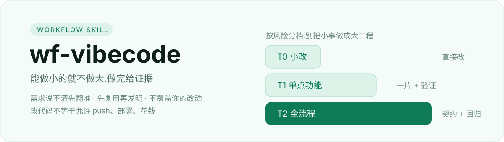

# wf-vibecode



把「我想做个东西」变成在你自己机器上真的能跑、能验收的改动。

一句话原则:**能做小的就不做大,做完必须有能验证的证据。**

## 怎么走

**底座(默认全走,按车道裁剪)**:需求翻译 → 摸现场与查库 → 定档与边界 → 结构草图(按需) → 先找可复用的 → 骨架与逐片实现 → 验证说真话 → 收口交付

**车道(选一条)**:

| 车道 | 什么时候走 |
| --- | --- |
| 1 小改直通(T0) | 文案、样式、改法明确的小缺陷 |
| 2 单点功能(T1) | 一个用户能感觉到的功能,边界清楚 |
| 3 全流程(T2) | 新产品、多层改动、登录、数据迁移、外部集成 |
| 4 故障修复 | 有明确报错或行为不对 |
| 5 已有产物收口 | 实现已完成,只要打包、上传、推送 |
| 6 收尾治理 | 文档、测试、worktree 乱了 |

拿不准先按 2 走;做起来发现跨了多层、动了数据或权限,再升到 3。降档不等于跳过安全与回归检查。

结构说不清时,先决定用户要不要看图:点改在对话里说清五句话;面改简单的给施工单,跨模块的用 `project-map`;大改在开头和收口各给一张 `project-map`,复杂时再用 `arch-grower` 在后台存图。没有默认版式,按内容选配方;内容少就直接说,不硬做卡。

需求说不清的话,先把它翻成「准话」再动手;现场摸不全,就访问你一轮,只问代码里查不到的。

过程中它会顺手做两件记录:用到的术语记进项目的 `docs/术语表.md`(词条 + 对应功能),需求背景写进项目 `AGENTS.md`——以后新会话和别的 AI 能一眼接上。

- 故障修复先复现、再找根因，用 `oil-bug-fix`；原因和改法已经明确的，按 T0 直接修。
- 验证分三层：编码途中只跑秒级检查，写完跑关联快测，全量测试与构建留到合并前一次跑完。
- T2 从零开发先搭可运行骨架，再走通一条真实数据与权限链路；数据、秘密、预览和回滚清单见 `references/product-delivery.md`。
- `development-reference-library` 按开发问题提供官方文档、聚合服务、Skill、MCP/CLI/API 和案例入口；不默认安装、登录或创建云资源。

## 三条刹车

- 只在缺的信息会改变用户能看见的行为、数据安全、认证、付费或对外副作用时才问,一次问完。
- 破坏性动作先问:删数据、改表结构、覆盖别人正在改的文件、强推、改线上配置。
- **改代码不等于允许 push、部署、发布、花钱。** 用户明确点名了才做。

## 验证不靠嘴说

```bash
py -3 scripts/run_checks.py            # 只列出这个项目该跑什么检查
py -3 scripts/run_checks.py --yes      # 确认后执行,逐项记录命令、退出码、耗时、输出尾部
```

它从项目里认出测试、lint、类型检查和构建命令(`package.json`、pytest、Cargo、Go、Makefile,以及 `AGENTS.md` 里写的命令)。程序没装会标「跑不了」,不算失败。

跑完给一行结论:通过、命中还是跑不动,括号里都写着原因,不用记编号。

web 界面类改动可以挂 `webapp-testing`,用真实浏览器把关键路径点一遍。

## 安装

```bash
npx skills add hayou2002/wf-vibecode
```

## 依赖

故障修复另需 `oil-bug-fix` 0.1.1(与 `oil-*` 同一仓库);委派是可选项,没有 `wf-agent-team` 也能由当前单 Agent、单模型完整运行。
确需派遣时优先 Codex Host,不可用时才回退 Magpie `wf-*` 角色;每批具体方案都由用户明确允许后才执行。

`codex-vibecoding`(分档、复用、证据这些细则的来源)、`vibehub`(把口语需求翻准)、`oil-explore`、`oil-plan`、`oil-frontend`、`oil-code-review`、`oil-govern`、`oil-delegate`、`git-ship` 1.1.0,以及同系列的 `wf-github-ops`、`wf-design`;`webapp-testing`(可选,web 界面真浏览器验证)。按车道取用,不必全装。

- 面改/大改另需 [project-map](https://github.com/hayou2002/project-map):按内容选配方,按场景换清纸 / 雾蓝 / 便笺;需要内部状态时再用 `arch-grower`。
- 版本基线见 `references/environment.md`;当前对齐 `git-ship 1.1.0`、`oil-bug-fix 0.1.1`。

## 同系列

- [project-map](https://github.com/hayou2002/project-map):把项目现状画成非专业用户一眼能懂的卡片
- [wf-maker](https://github.com/hayou2002/wf-maker):把流程做成工作流 Skill
- [wf-github-ops](https://github.com/hayou2002/wf-github-ops):本地 Git 整理与 GitHub 上传
- [wf-design](https://github.com/hayou2002/wf-design):网页、界面、交互与视觉设计；真实业务和数据集成本工作流负责

## 许可

MIT
